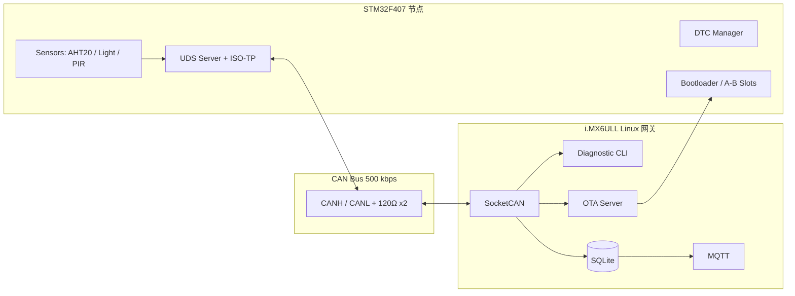

# STM32 + i.MX6ULL | CAN 诊断与 OTA 闭环系统

> 从“CAN 能通”升级到“可诊断、可升级、可恢复、可度量”。

**Status:** 🚧 仓库骨架 / 进行中。代码和测试数据会按里程碑逐步提交，未完成项不会写成“已实现”。

---

## 1. 项目定位

这是一个**增量项目**，不是从零重写。

基线已经具备：

- STM32F407 与 i.MX6ULL 双机 CAN 500 kbps 通信；
- AHT20 温湿度、光照、HC-SR501 人体感应采集；
- Linux SocketCAN 收发程序。

本项目在此基础上增加三个闭环：

| 闭环 | 新增能力 | 结果 |
|---|---|---|
| 诊断闭环 | ISO-TP 多帧 + UDS 子集 + DTC | 能读版本、读/清故障码、保持诊断会话 |
| 升级闭环 | CAN Bootloader + A/B 分区 + CRC32 + 回滚 | 能通过 CAN 升级，掉电不变砖 |
| 可靠性闭环 | bus-off 恢复、故障注入、24h/72h 测试 | 用数据证明稳定，而不是“目测能跑” |

一句话：

> 基于 STM32F407 + i.MX6ULL 的车载风格 CAN 诊断与 OTA 闭环系统。

---

## 2. 系统架构



核心链路：**STM32 节点负责采集、诊断服务、DTC 和 Bootloader；i.MX6ULL 负责诊断客户端、OTA 服务端、日志和上报。**

---

## 3. 相比 baseline 新增什么

| 能力 | Baseline（已有） | 本项目（新增） |
|---|---|---|
| CAN 传输 | 双机 500 kbps 能收发 | 错误帧统计、bus-off 恢复、总线负载/延迟测试 |
| 应用协议 | 0x301/0x302/0x401/0x402/0x403 | ISO-TP 多帧 + UDS 诊断 + DTC |
| 诊断 | 无 | `0x10 / 0x3E / 0x22 / 0x19 / 0x14` |
| 故障管理 | 无 | 5 类 DTC、状态位、掉电存储、读/清 |
| 升级 | 无 | CAN Bootloader、A/B 分区、CRC32、断点续传、回滚 |
| Linux 网关 | SocketCAN 收发 | 诊断 CLI、OTA 服务端、SQLite、MQTT、systemd |
| 证据 | 博客/功能演示 | 测试报告 + 故障注入 + 24h/72h 数据 + demo |

**Baseline 只保留一句简历描述，不占主 bullet。** 主 bullet 全部留给新增能力。

---

## 4. 项目范围（A 方案）

### 4.1 UDS 子集

| 服务 | 名称 | 说明 |
|---|---|---|
| `0x10` | DiagnosticSessionControl | 默认会话 / 扩展会话 |
| `0x3E` | TesterPresent | 保持会话 |
| `0x22` | ReadDataByIdentifier | 读版本、运行时间、错误计数 |
| `0x19` | ReadDTCInformation | 子功能 `0x02`，按状态掩码读 DTC |
| `0x14` | ClearDiagnosticInformation | 清除 DTC |

可选进阶（不作为本期必做）：

- `0x27` SecurityAccess：简化 seed/key，仅演示流程，不宣称量产安全；
- `0x34/0x36/0x37`：UDS 方式 OTA。先完成自定义 OTA，再考虑包装。

### 4.2 DTC

| DTC | 含义 | 触发条件 |
|---|---|---|
| `0xC001` | AHT20 超时/CRC 错 | I2C 连续失败 3 次 |
| `0xC002` | CAN bus-off | 检测到 bus-off |
| `0xC003` | OTA CRC 失败 | 升级包校验失败 |
| `0xC004` | 传感器越界 | ADC/温湿度超出阈值 |
| `0xC005` | Flash 错误 | 擦写/校验失败 |

### 4.3 OTA

- 升级只写非活动分区；
- CRC32 + 向量表校验；
- 支持断点续传；
- trial / confirm / rollback；
- 验收：50 次升级、25%/50%/75% 掉电测试。

### 4.4 明确不做

- 不做完整 AUTOSAR；
- 不做功能安全认证；
- 不做完整 UDS 全服务；
- 不把“简化 security access”宣传成安全方案。

---

## 5. 硬件

| 硬件 | 作用 | 备注 |
|---|---|---|
| STM32F407VGT6-Disc | CAN 节点 / UDS Server / Bootloader | 具体引脚按原理图确认 |
| i.MX6ULL mini EMMC | Linux 网关 / 诊断客户端 / OTA Server | 板载 CAN 或 MCP2515 |
| CAN 收发器 ×2 | 物理层 | 优先 SN65HVD230 / TJA1051T/3（3.3V） |
| AHT20 | 温湿度 | I2C，3.3V，4.7k 上拉 |
| 光敏模块 | 光照 | ADC，电压不超过 3.3V |
| HC-SR501 | 人体感应 | 5V 供电，输出 3.3V，共地 |
| 120Ω ×2 | 终端电阻 | 总线两端各一个 |
| USB-TTL | 调试串口 | 115200 |
| 示波器/逻辑分析仪 | 底层调试 | 排查晶振、SPI、CAN 波形 |

> 详细接线与 bring-up 步骤见 [`docs/bringup.md`](docs/bringup.md)，旧代码审计见 [`docs/baseline-audit.md`](docs/baseline-audit.md)。

---

## 6. 仓库结构

```text
.
├── README.md
├── .gitignore
├── docs/
│   ├── README.md
│   ├── scope-a.md
│   ├── baseline-audit.md
│   ├── protocol.md
│   ├── test-report.md
│   └── blog-series.md
├── firmware/          # STM32 应用：传感器、UDS、DTC、OTA client
├── bootloader/        # STM32 Bootloader：A/B、CRC、跳转、回滚
├── gateway/           # i.MX6ULL Linux 网关：SocketCAN、诊断、OTA、SQLite、MQTT
├── test/              # 测试脚本、测试记录、故障注入
└── tools/             # 抓包、诊断 CLI、辅助脚本
```

每个目录的职责见对应 `README.md`。

---

## 7. 快速开始（占位）

> 代码尚未提交，以下命令用于说明最终的使用方式，后续按里程碑更新。

### 7.1 依赖

```bash
sudo apt install can-utils sqlite3 libsqlite3-dev libmosquitto-dev mosquitto
```

### 7.2 启动 CAN

```bash
sudo ip link set can0 down
sudo ip link set can0 up type can bitrate 500000 sample-point 0.875
ip -details -statistics link show can0
candump -ta can0
```

### 7.3 交叉编译网关

```bash
arm-linux-gnueabihf-gcc -O2 -Wall -Wextra -pthread \
  -o can-gateway gateway/*.c \
  -lsqlite3 -lmosquitto
```

### 7.4 运行

```bash
scp can-gateway root@<board-ip>:/usr/bin/
ssh root@<board-ip> systemctl restart can-gateway
```

---

## 8. 测试状态

| 测试 | 目标 | 状态 |
|---|---|---|
| ISO-TP 单帧/多帧 | 4 KB 传输 0 错误 | 待实现 |
| UDS `0x10/0x3E/0x22` | 响应 < 50 ms | 待实现 |
| UDS `0x19/0x14` | 5 类 DTC 可读/可清 | 待实现 |
| Bootloader A/B | 两个分区都能启动 | 待实现 |
| OTA | 50 次成功，掉电可回滚 | 待实现 |
| 24h 稳定性 | 丢帧 < 0.01%，P99 < 50 ms | 待实现 |
| bus-off 恢复 | 3 s 内恢复 | 待实现 |

**未测试的项目不会写成“已通过”。**

---

## 9. Roadmap

- [x] 创建仓库骨架
- [ ] 完成 baseline 审计，打 `a-baseline` tag
- [ ] ISO-TP：SF / FF / CF / FC
- [ ] UDS：`0x10 / 0x3E / 0x22`
- [ ] UDS：`0x19 / 0x14` + DTC 存储
- [ ] Bootloader：A/B、CRC32、跳转
- [ ] OTA：分片、ACK、断点续传、回滚
- [ ] Linux 网关：诊断 CLI + OTA + SQLite + MQTT
- [ ] 故障注入 + 24h/72h 测试
- [ ] README、demo 视频、测试报告
- [ ] 博客系列收尾

---

## 10. 文档

- [项目 A 范围](docs/scope-a.md)
- [Baseline 审计](docs/baseline-audit.md)
- [CAN / ISO-TP / UDS / OTA 协议](docs/protocol.md)
- [测试记录模板](docs/test-report.md)
- [博客系列索引](docs/blog-series.md)

---

## 11. 博客系列

CSDN：`blog.csdn.net/longlin101`

系列索引见 [`docs/blog-series.md`](docs/blog-series.md)。

计划文章：

1. 从“CAN 能通”到“可诊断、可升级”
2. 基线审计：旧 CAN 项目哪些能复用
3. ISO-TP 多帧：SF/FF/CF/FC、BlockSize/STmin
4. UDS 子集：`0x10/0x3E/0x22/0x19/0x14` + DTC
5. CAN Bootloader：A/B 分区、CRC32、跳转、回滚
6. OTA 实战：50 次升级与掉电测试
7. Linux 网关：SocketCAN + 诊断 CLI + SQLite
8. i.MX6ULL IIO 驱动：AHT20 从设备树到用户态
9. PIR 字符驱动：threaded IRQ + poll + hrtimer
10. 测试报告：24h/72h、P99、bus-off 数据

---

## 12. 说明

- 这是一个学习/求职作品，不是量产 AUTOSAR/UDS 协议栈；
- 安全访问（如果实现）是简化流程，不代表量产安全；
- 所有性能数字以 `docs/test-report.md` 的实测记录为准；
- 基线代码来自之前的 CAN 实验，新增代码会单独提交，便于看出增量。
